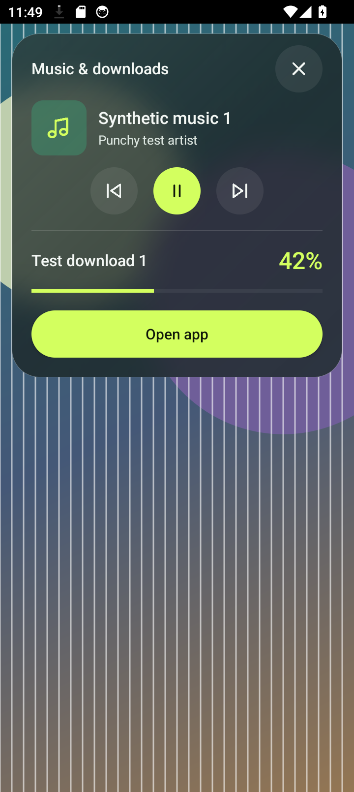

<p align="center">
  
</p>

<h1 align="center">Punchy</h1>

<p align="center">Your downloads, around your camera.</p>

<p align="center">
  <a href="https://github.com/justinebacurin1927/Punchy/releases/tag/v0.1.5"><strong>Download the latest APK</strong></a>
</p>

Punchy puts a download progress ring around your phone’s camera. Tap it to see your download, or view your music and download together in a glass card.

Made for Jaycee’s **HONOR X7c · Android 14 / MagicOS 8**. No root or Xposed needed.

## Get started

1. Open the [latest release](https://github.com/justinebacurin1927/Punchy/releases/tag/v0.1.5).
2. Under **Assets**, download **Punchy-0.1.5-debug.apk** and install it. If you already have Punchy, install over it to keep your settings.
3. Open Punchy and allow the two settings under **Setup**.
4. Turn on **Enable Punchy**, then try **Preview on phone**.
5. Use **Adjust shape & alignment** to fit the ring around your camera.

Download the APK from the release’s **Assets** section.

## Make it yours

- **Download apps:** include every app, or choose the ones you want.
- **Music capsule apps:** choose music players for the wide ring. Muzio, Spotify and YouTube Music are included by default. Video apps are left out.
- **Quick Settings:** open **More setup options → Add Quick Settings tile** for an easy on/off switch.



The glass uses your phone’s background blur when available. If your phone turns blur off, Punchy uses a darker background to keep the text readable.

## If a download doesn’t appear

Make sure the downloading app shows progress in your phone’s notifications. Then open **Download detection** in Punchy and tap **Refresh notifications**.

Punchy shows a short status and the next step to try. If you need help, tap **Copy detection report** and share it when asked. The copied report leaves out message text and filenames.

[More setup help](docs/INSTALL.md)

## Before using a banking app

Tap **Turn off Accessibility** near the main switch, or tap the ring and use the same button in its expanded card. This stops the ring and turns off Punchy's actual Android Accessibility service. Notification access stays enabled.

When you want the ring again, open Punchy → **Enable Accessibility**, turn on **Punchy progress ring** in Android settings, then return and turn on **Enable Punchy**. Your alignment and app choices are kept.

The normal on/off switch and existing Quick Settings tile only hide the ring; they do not turn off Accessibility. A banking app may require additional steps. Follow its instructions if the warning remains.

## Privacy, security and verification

Punchy is an experimental personal project, distributed here as a **development-signed debug APK**. Public source and checksums let you inspect it; they are not bank approval or an independent security audit.

- [Privacy and permissions](PRIVACY.md): what notification access exposes, why Accessibility is used, and what stays on when paused.
- [Security policy and private vulnerability reporting](SECURITY.md).
- [Verify an APK](docs/VERIFY.md): release SHA-256, signing-certificate fingerprint and source/build instructions.

## What’s new in 0.1.5

- Turn off the actual Accessibility service from the main screen or expanded island.
- Clear paused status and a route back to Android settings to enable it yourself.
- Permission/privacy documentation, security reporting and APK verification details.

Your download behavior, glass island, calibration and selected apps are kept.

## About the project

Punchy reads download notifications from other apps; it does not download files itself. It is a separate camera-area display and cannot read HONOR’s private capsule size. The ring hides when idle, locked or in landscape.

The original idea came from [hxreborn/punch-hole-download-progress](https://github.com/hxreborn/punch-hole-download-progress). That project uses Xposed; Punchy uses Android’s notification access and a drawing-only accessibility service. [Reference notes](docs/research.md).

The app has no ads or analytics. Its accessibility service does not read your screen or control taps.

<details>
<summary>Build and verification</summary>

Native Java Android app, minimum Android 14. JDK 17+, Android SDK 35 and Build Tools 34.0.0. Configure your local SDK in untracked `local.properties`, then run:

```sh
./gradlew :app:assembleDebug :app:lintDebug
./scripts/test-core.sh
```

APK: `app/build/outputs/apk/debug/app-debug.apk`.

[Latest verification](docs/verification/v0.1.5/summary.md) · [Design notes](docs/design/punchy-glass-direction.md)

Emulator-only fixtures are separate from the installed Punchy app. [Test scripts](scripts/) refuse to run against a physical phone.

</details>
